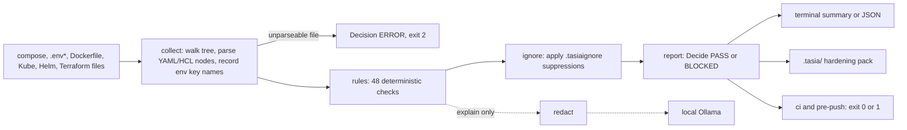

# Tasia

[](https://github.com/joeyvictorino/tasia/actions/workflows/test.yml)
[](LICENSE)

Tasia is a static gate for self-hosted AI stacks, written in Go. It reads Docker Compose, `.env*`, Dockerfile, Caddyfile, nginx.conf, Kubernetes manifest, Helm `values.yaml` and Terraform `.tf` files, applies 48 deterministic rules (inference APIs, chat UIs, vector databases, data stores and agent runtimes published on every interface, mounted Docker socket, privileged containers, wildcard CORS, mutable image tags, writable project mounts on agent runtimes, auto-approve/code-execution settings on agent runtimes, Lambda/ECS container security, cloud firewall and storage misconfigurations and similar), and reports each finding with `file:line`, why it matters and a fix. It blocks a push or a CI job on a severity threshold and writes a hardening pack to `.tasia/` without touching your sources. It never reads secret values into findings, never calls the internet, and fails closed on anything it cannot parse. It exists because local models, UIs and vector databases are routinely started with default ports open on all interfaces, and "private AI" is only private if the exposure is checked.


## Quickstart

Requires Go 1.26+ (see `go.mod`). Every command below was run from a clean clone.

```bash
git clone https://github.com/joeyvictorino/tasia
cd tasia
go build -o tasia ./cmd/tasia

# Review the bundled deliberately-messy stack (prints findings, writes nothing)
./tasia review --path examples/messy-ollama-stack --no-write

# Use it as a gate: exit 1 = blocked, 0 = pass, 2 = tool or config error
./tasia ci --path examples/messy-ollama-stack;    echo "exit: $?"   # 1
./tasia ci --path examples/hardened-ollama-stack; echo "exit: $?"   # 0
./tasia ci --path examples/messy-agent-stack;      echo "exit: $?"   # 1: exposed n8n with a writable project mount
```

Expected output of the first command:

```
TASIA
Decision: BLOCKED
Risk: HIGH
[HIGH] docker-compose.yml:5 Inference API published to all interfaces
[HIGH] docker-compose.yml:9 Open WebUI/Gradio UI published to all interfaces
[HIGH] docker-compose.yml:13 Vector DB published to host
[MEDIUM] docker-compose.yml:3 image uses latest
...
```

Without `--no-write`, `review` also writes the hardening pack to `.tasia/` inside the scanned directory.

### Other ways to install

Prebuilt binaries (darwin and linux, amd64 and arm64) are attached to each [release](https://github.com/joeyvictorino/tasia/releases) with a `checksums.txt`:

```bash
VERSION=v0.1.2
curl -sSfL "https://github.com/joeyvictorino/tasia/releases/download/${VERSION}/tasia_${VERSION#v}_darwin_arm64.tar.gz" | tar xz
./tasia version
```

`go install github.com/joeyvictorino/tasia/cmd/tasia@latest` installs the latest release. Use `@v0.1.2` to pin this version. The `v0.1.0` and `v0.1.1` tags predate the module-path rename and are not installable by module path.

## What it checks

48 deterministic rules across eight categories. Rule IDs are stable identifiers for `.tasiaignore` entries, inline suppression comments, and severity overrides.

### Compose (14 rules)

| ID | Rule | Default |
|----|------|---------|
| `exposed_inference` | Inference API (Ollama, vLLM, llama.cpp, LM Studio) published to all interfaces | HIGH |
| `exposed_ui` | Chat UI (Open WebUI, Gradio) published to all interfaces | HIGH |
| `exposed_vector` | Vector DB (Qdrant, Chroma, Weaviate, Milvus) published to host | HIGH |
| `exposed_datastore` | Data store (Redis, Valkey, Postgres, pgvector) published to all interfaces | MEDIUM |
| `exposed_agent_runtime` | Agent runtime (n8n, Flowise, Langflow, Dify, OpenHands) published to all interfaces | HIGH |
| `docker_socket_mount` | Docker socket (`/var/run/docker.sock`) mounted into container | CRITICAL |
| `privileged_container` | Container runs with `privileged: true` | CRITICAL |
| `permissive_cors` | Permissive CORS such as `OLLAMA_ORIGINS=*` | HIGH |
| `latest_image` | `image:` with `:latest` or no tag | MEDIUM |
| `broad_bind_mount` | Broad writable bind mount such as `.:/app` (HIGH on agent runtimes) | MEDIUM |
| `env_token_key` | Token/secret key name in `.env` or compose `environment:` (value never read) | MEDIUM |
| `env_hardcoded_secret` | Value matches known secret pattern (`sk-`, `ghp_`, `AKIA`, JWT, hex/base64); value never emitted | HIGH |
| `no_internal_network` | Multi-service stack publishing ports with no `internal: true` network | MEDIUM |
| `vector_db_no_auth` | Chroma or Weaviate without authentication configuration | LOW |

### Agent (4 rules)

| ID | Rule | Default |
|----|------|---------|
| `agent_auto_approve` | Auto-approve or code-execution settings (`N8N_ALLOW_EXEC`, `AUTO_APPROVE`, etc.) | HIGH |
| `agent_shared_secret` | Same secret key used by multiple agent runtime services | HIGH |
| `agent_test_mount` | Test/fixture directory (`test/`, `spec/`, `fixtures/`, etc.) mounted writable into agent | HIGH |
| `agent_auto_restart` | Agent runtime with `restart: always` or `unless-stopped` | MEDIUM |

### Dockerfile (3 rules)

| ID | Rule | Default |
|----|------|---------|
| `dockerfile_user_root` | `USER root` or `USER 0` (or no `USER` directive) | HIGH |
| `dockerfile_expose` | `EXPOSE` directive (informational) | LOW |
| `dockerfile_expose_sensitive` | `EXPOSE` of sensitive port (database, SSH, Docker daemon) | MEDIUM |

### Reverse Proxy (1 rule)

| ID | Rule | Default |
|----|------|---------|
| `reverse_proxy_no_auth` | Caddyfile or nginx proxy with no `basic_auth`, `forward_auth` or `auth_request` | MEDIUM |

### Kubernetes (6 rules)

| ID | Rule | Default |
|----|------|---------|
| `kube_exposed_service` | Service type LoadBalancer or NodePort | HIGH |
| `kube_privileged` | Container with `privileged: true` | CRITICAL |
| `kube_run_as_root` | Container running as root (`runAsUser: 0` or `runAsNonRoot: false`) | HIGH |
| `kube_host_network` | Pod with `hostNetwork: true` | HIGH |
| `kube_host_path` | hostPath volume mount (CRITICAL for sensitive paths like Docker socket) | HIGH |
| `kube_no_network_policy` | Workloads without a NetworkPolicy | MEDIUM |

### Helm (1 rule)

| ID | Rule | Default |
|----|------|---------|
| `helm_insecure_default` | `values.yaml` insecure defaults (privileged, hostNetwork, runAsUser 0, etc.) | HIGH |

### Terraform (19 rules)

| ID | Rule | Default |
|----|------|---------|
| `tf_sg_ingress_all` | AWS security group allows all inbound (`0.0.0.0/0`, all ports) | CRITICAL |
| `tf_sg_ingress_sensitive` | AWS security group exposes sensitive port to internet | HIGH |
| `tf_sg_ingress_wide` | AWS security group allows internet ingress on non-sensitive port | MEDIUM |
| `tf_s3_public_acl` | S3 bucket with `public-read` or `public-read-write` ACL | HIGH |
| `tf_iam_admin_access` | IAM policy with `Action: *` and `Resource: *` | CRITICAL |
| `tf_iam_star_actions` | IAM policy with `Action: *` | HIGH |
| `tf_lambda_admin_role` | Lambda function with `AdministratorAccess` execution role | HIGH |
| `tf_lambda_vpc_no_sg` | Lambda in VPC with empty `security_group_ids` | MEDIUM |
| `tf_ecs_privileged` | ECS task definition with `privileged: true` container | HIGH |
| `tf_ecs_root` | ECS task definition with `user: root` or `user: 0` | MEDIUM |
| `tf_gcp_firewall_ingress_all` | GCP firewall allows all inbound (`0.0.0.0/0`, all ports) | CRITICAL |
| `tf_gcp_firewall_ingress_sensitive` | GCP firewall exposes sensitive port to internet | HIGH |
| `tf_gcp_firewall_ingress_wide` | GCP firewall allows internet ingress on non-sensitive port | MEDIUM |
| `tf_gcp_storage_public` | GCP storage bucket grants `allUsers` or `allAuthenticatedUsers` | HIGH |
| `tf_azure_nsg_ingress_all` | Azure NSG allows all inbound (`*`, all ports) | CRITICAL |
| `tf_azure_nsg_ingress_sensitive` | Azure NSG exposes sensitive port to internet | HIGH |
| `tf_azure_nsg_ingress_wide` | Azure NSG allows internet ingress on non-sensitive port | MEDIUM |
| `tf_azure_storage_public` | Azure storage with `allow_blob_public_access = true` | HIGH |

### Manifest (1 rule)

| ID | Rule | Default |
|----|------|---------|
| `no_ai_stack_manifest` | No `ai-stack-manifest.json` found | LOW |

Exact match rules, ports and image substrings are in [`docs/rules.md`](docs/rules.md). A port bound to `127.0.0.1`, `localhost` or `::1` is treated as safe.

Agent runtimes get their own rule because they are not chat windows: they execute tools and model-written code with whatever credentials they hold. A writable mount of the project on such a service is rated HIGH because the agent can then edit the tests or check scripts that judge its own output, and "all checks pass" stops meaning anything. `examples/messy-agent-stack` shows both.

## What it does not do

- It does not scan networks or running containers; it only reads files.
- It does not edit your files, read secret values into findings, call the internet or collect telemetry. The only optional network call is `tasia explain` to a local Ollama you run.
- It does not prove security or compliance. A PASS means no rule matched.
- The generated `docker-compose.hardened.override.yml` is a suggestion, not a drop-in file. Compose appends `ports` lists when merging files, so apply the changes to your base file (or use the `!override` tag) and check with `docker compose config`. The file says this in its header.

## Commands

```
tasia review --path .  [--format text|json|sarif] [--fail-on critical|high|medium|low] [--baseline FILE] [--no-write] [--strict]
tasia ci     --path .  [--fail-on critical|high|medium|low] [--baseline FILE]   # default: high
tasia diff   --base DIR --current DIR [--format text|json] [--fail-on critical|high|medium|low]
tasia install --pre-push          # git hook that runs: tasia ci --path . --fail-on high
tasia uninstall --pre-push
tasia explain [--path .] [--ollama MODEL] [--ollama-host HOST[:PORT]]
tasia rules  [--format text|json]
tasia schema
tasia version
```

- `review` reports and exits 0 when it completes, whatever the decision; use `ci` (or the pre-push hook) to gate. `--format json` prints pure JSON on stdout. `--format sarif` prints SARIF v2.1.0 JSON for upload to GitHub Code Scanning (see `.github/workflows/sarif.yml`).
- `diff` compares two scan directories and reports new, fixed and unchanged findings. With `--fail-on`, exits 1 if any new finding is at or above the threshold. Useful for CI gating on regressions.
- `schema` prints the JSON Schema that describes the `--format json` output (see [`docs/findings-schema.json`](docs/findings-schema.json)). Use it to validate output or generate types in other languages.
- `ci` exits 0 (pass), 1 (blocked at or above `--fail-on`) or 2 (tool or config error).
- Fails closed: a compose or env file that cannot be parsed gives `Decision: ERROR` and exit 2, never PASS. An unknown `--fail-on` value is also exit 2.
- `--baseline FILE` on `review` or `ci` loads a previous SARIF output and suppresses any finding that already appears in it (matched by rule ID, file and line). Use it to gate on new findings only: run `tasia review --format sarif > baseline.sarif` once, then `tasia ci --baseline baseline.sarif` in CI.
- `explain` sends only the redacted findings to a local Ollama (default `localhost:11434`) and writes `.tasia/LLM_REVIEW.md`. Without `--ollama` it only writes the redacted facts and sends nothing. `review` and `ci` never call a model.

## `.tasiaignore`

Drop a `.tasiaignore` file at the root of the scanned directory to suppress known or accepted findings. One entry per line:

```
# Suppress a rule everywhere
latest_image

# Suppress all findings in a file
docker-compose.dev.yml

# Suppress a rule only in a specific file (order doesn't matter)
exposed_inference docker-compose.dev.yml

# Glob patterns work for file matching
examples/*
```

Rule IDs are the `id` values from `--format json` output (e.g. `exposed_inference`, `latest_image`, `docker_socket_mount`). A bare word containing only `[a-z0-9_]` is treated as a rule ID; anything else is a file pattern. Lines starting with `#` are comments. Inline comments work too: `latest_image  # acceptable for dev`.

The ignore policy applies to `review`, `ci` and `explain`. Suppressed findings are removed before the decision, so a BLOCKED stack can become PASS if the blocking findings are all suppressed.

## Inline suppression

For one-off exceptions, add a comment directly in the config file instead of a `.tasiaignore` entry:

```yaml
services:
  ollama:
    image: ollama/ollama  # tasia:disable=latest_image
    ports:
      # tasia:disable=exposed_inference
      - "11434:11434"
```

Supported comment styles: `# tasia:disable=rule_id` (YAML, env, Dockerfile, Caddyfile) and `// tasia:disable=rule_id` (Terraform/HCL). Multiple rules: `# tasia:disable=rule_a,rule_b`. A directive suppresses the comment's own line and the line immediately below it, so the comment can sit above the flagged line. Inline suppressions combine with `.tasiaignore` — both are checked.

## `.tasiarc.yaml`

Drop a `.tasiarc.yaml` (or `.tasiarc.yml`) at the root of the scanned directory to override default severities:

```yaml
severities:
  latest_image: low          # downgrade from MEDIUM
  exposed_inference: critical # escalate from HIGH
  no_ai_stack_manifest: low  # you know what you're doing
```

Rule IDs are the same as in `.tasiaignore` and `--format json` output. Values must be `CRITICAL`, `HIGH`, `MEDIUM` or `LOW` (case-insensitive). Invalid severity values are silently ignored.

Severity overrides apply after `.tasiaignore` suppressions and before the decision, so they affect the `--fail-on` threshold.

## What `.tasia/` contains

`HARDENING_PLAN.md`, `EXECUTIVE_MEMO.md`, `ai-stack-manifest.json`, `docker-compose.hardened.override.yml`, `firewall-notes.md`, `findings.json`, `findings.toon` (compact agent-readable format), and `LLM_REVIEW.md` only after `tasia explain`. See [`docs/generated-artifacts.md`](docs/generated-artifacts.md).

## Architecture



| Package | Role |
|---------|------|
| `cmd/tasia` | entry point |
| `internal/cli` | command dispatch, flags, exit codes, git hook install |
| `internal/collect`, `internal/collect/compose` | tree walk, compose parsing with line numbers (yaml.v3 nodes), env key-name extraction |
| `internal/rules` | the deterministic rules and the `Finding` model |
| `internal/ignore` | `.tasiaignore` parser and finding suppression |
| `internal/config` | `.tasiarc.yaml` parser for severity overrides |
| `internal/report` | decision, terminal and JSON output, `.tasia/` artifacts |
| `internal/llm` | redaction and the optional Ollama client |

## Tests

```bash
go test ./... -race -count=1
gofmt -l . && go vet ./...
```

CI ([`.github/workflows/test.yml`](.github/workflows/test.yml)) runs the same, plus the documented exit codes against the bundled examples and a `go mod tidy` check. Test fixtures are in `testdata/` and `examples/`.

## Docs

[`docs/rules.md`](docs/rules.md), [`docs/threat-model.md`](docs/threat-model.md), [`docs/roadmap.md`](docs/roadmap.md), [`CONTRIBUTING.md`](CONTRIBUTING.md), [`SECURITY.md`](SECURITY.md).

## License

Apache-2.0, see [`LICENSE`](LICENSE).

## Name and author

The name is a nod to my daughter Anastasia and to the AI stacks this tool protects.

Built by [Joey Victorino](https://joeyvictorino.com). Tasia automates part of the published [Local AI Deployment Hardening Checklist](https://joeyvictorino.com/checklist.html).
