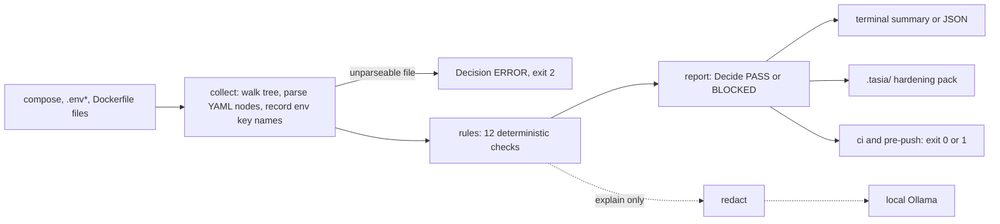

# Tasia

[](https://github.com/joeyvictorino/tasia/actions/workflows/test.yml)
[](LICENSE)

Tasia is a small Go command-line gate for self-hosted AI stacks. It reads Docker Compose files and `.env*` files, applies 12 deterministic rules (inference APIs, chat UIs, vector databases and data stores published to every interface, mounted Docker socket, privileged containers, wildcard CORS, mutable image tags and similar), and reports each finding with `file:line`, why it matters and a fix. It can block a push or a CI job on a severity threshold, and it writes a hardening pack to `.tasia/` without touching your sources. It exists because local models, UIs and vector databases are routinely started with default ports open on all interfaces, and "private AI" is only private if the network exposure is checked.


## Quickstart

Requires Go 1.26+ (see `go.mod`). Every command below was run from a clean clone.

```bash
git clone https://github.com/joeyvictorino/tasia
cd tasia
go build -o tasia ./cmd/tasia

# Review the bundled deliberately-messy stack (prints findings, writes nothing)
./tasia review --path examples/messy-ollama-stack --no-write

# Use it as a gate: exit 1 = blocked, 0 = pass, 2 = tool or config error
./tasia ci --path examples/messy-ollama-stack;    echo "exit: $?"   # 1
./tasia ci --path examples/hardened-ollama-stack; echo "exit: $?"   # 0
```

Expected output of the first command:

```
TASIA
Decision: BLOCKED
Risk: HIGH
[HIGH] docker-compose.yml:5 Inference API published to all interfaces
[HIGH] docker-compose.yml:9 Open WebUI/Gradio UI published to all interfaces
[HIGH] docker-compose.yml:13 Vector DB published to host
[MEDIUM] docker-compose.yml:3 image uses latest
...
```

Without `--no-write`, `review` also writes the hardening pack to `.tasia/` inside the scanned directory.

### Other ways to install

Prebuilt binaries (darwin and linux, amd64 and arm64) are attached to each [release](https://github.com/joeyvictorino/tasia/releases) with a `checksums.txt`:

```bash
VERSION=v0.1.1
curl -sSfL "https://github.com/joeyvictorino/tasia/releases/download/${VERSION}/tasia_${VERSION#v}_darwin_arm64.tar.gz" | tar xz
./tasia version
```

`go install github.com/joeyvictorino/tasia/cmd/tasia@main` works. `@latest` currently fails: the `v0.1.0` and `v0.1.1` tags predate the module-path rename and still declare `github.com/dzh01/tasia`, so Go refuses them. Fixing `@latest` needs a new release tag.

## What it checks

| Rule | Severity |
|------|----------|
| Inference API (Ollama, vLLM, llama.cpp, LM Studio) published to all interfaces, including `network_mode: host` | HIGH |
| Open WebUI or Gradio published to all interfaces | HIGH |
| Vector DB (Qdrant, Chroma, Weaviate, Milvus) published to the host | HIGH |
| Data store (Redis, Valkey, Postgres, pgvector) published to all interfaces | HIGH alongside AI components, else MEDIUM |
| Docker socket mounted | CRITICAL |
| `privileged: true` | CRITICAL |
| Permissive CORS such as `OLLAMA_ORIGINS=*` | HIGH |
| Token or secret key names in `.env*` or compose `environment:` (names only, values are never read into findings) | MEDIUM |
| `image:` with `:latest` or no tag | MEDIUM |
| Broad, writable bind mounts such as `.:/app` | MEDIUM |
| Multi-service stack publishing ports with no `internal: true` network | MEDIUM |
| No `ai-stack-manifest.json` | LOW |

Exact match rules, ports and image substrings are in [`docs/rules.md`](docs/rules.md). A port bound to `127.0.0.1`, `localhost` or `::1` is treated as safe.

## What it does not do

- It does not scan networks or running containers; it only reads files.
- It does not analyze Dockerfiles yet. They are collected, but no rule uses them. Dockerfile `USER` and `EXPOSE` checks, Kubernetes manifests, Caddy and nginx checks, and SARIF output are on the [roadmap](docs/roadmap.md), not implemented.
- It does not edit your files, read secret values into findings, call the internet or collect telemetry. The only optional network call is `tasia explain` to a local Ollama you run.
- It does not prove security or compliance. A PASS means no rule matched.
- The generated `docker-compose.hardened.override.yml` is a suggestion, not a drop-in file. Compose appends `ports` lists when merging files, so apply the changes to your base file (or use the `!override` tag) and check with `docker compose config`. The file says this in its header.

## Commands

```
tasia review --path .  [--format text|json] [--fail-on critical|high|medium|low] [--no-write] [--strict]
tasia ci     --path .  [--fail-on critical|high|medium|low]     # default: high
tasia install --pre-push          # git hook that runs: tasia ci --path . --fail-on high
tasia uninstall --pre-push
tasia explain [--path .] [--ollama MODEL] [--ollama-host HOST[:PORT]]
tasia version
```

- `review` reports and exits 0 when it completes, whatever the decision; use `ci` (or the pre-push hook) to gate. `--format json` prints pure JSON on stdout.
- `ci` exits 0 (pass), 1 (blocked at or above `--fail-on`) or 2 (tool or config error).
- Fails closed: a compose or env file that cannot be parsed gives `Decision: ERROR` and exit 2, never PASS. An unknown `--fail-on` value is also exit 2.
- `explain` sends only the redacted findings to a local Ollama (default `localhost:11434`) and writes `.tasia/LLM_REVIEW.md`. Without `--ollama` it only writes the redacted facts and sends nothing. `review` and `ci` never call a model.

## What `.tasia/` contains

`HARDENING_PLAN.md`, `EXECUTIVE_MEMO.md`, `ai-stack-manifest.json`, `docker-compose.hardened.override.yml`, `firewall-notes.md`, `findings.json`, `findings.toon` (compact agent-readable format), and `LLM_REVIEW.md` only after `tasia explain`. See [`docs/generated-artifacts.md`](docs/generated-artifacts.md).

## Architecture



| Package | Role |
|---------|------|
| `cmd/tasia` | entry point |
| `internal/cli` | command dispatch, flags, exit codes, git hook install |
| `internal/collect`, `internal/collect/compose` | tree walk, compose parsing with line numbers (yaml.v3 nodes), env key-name extraction |
| `internal/rules` | the deterministic rules and the `Finding` model |
| `internal/report` | decision, terminal and JSON output, `.tasia/` artifacts |
| `internal/llm` | redaction and the optional Ollama client |

## Tests

```bash
go test ./... -race -count=1
gofmt -l . && go vet ./...
```

CI ([`.github/workflows/test.yml`](.github/workflows/test.yml)) runs the same, plus the documented exit codes against the bundled examples and a `go mod tidy` check. Test fixtures are in `testdata/` and `examples/`.

## Docs

[`docs/rules.md`](docs/rules.md), [`docs/threat-model.md`](docs/threat-model.md), [`docs/roadmap.md`](docs/roadmap.md), [`CONTRIBUTING.md`](CONTRIBUTING.md), [`SECURITY.md`](SECURITY.md).

## License

Apache-2.0, see [`LICENSE`](LICENSE).

## Name and author

The name is a nod to my daughter Anastasia and to the AI stacks this tool protects.

Built by [Joey Victorino](https://joeyvictorino.com). Tasia automates part of the published [Local AI Deployment Hardening Checklist](https://joeyvictorino.com/checklist.html).
